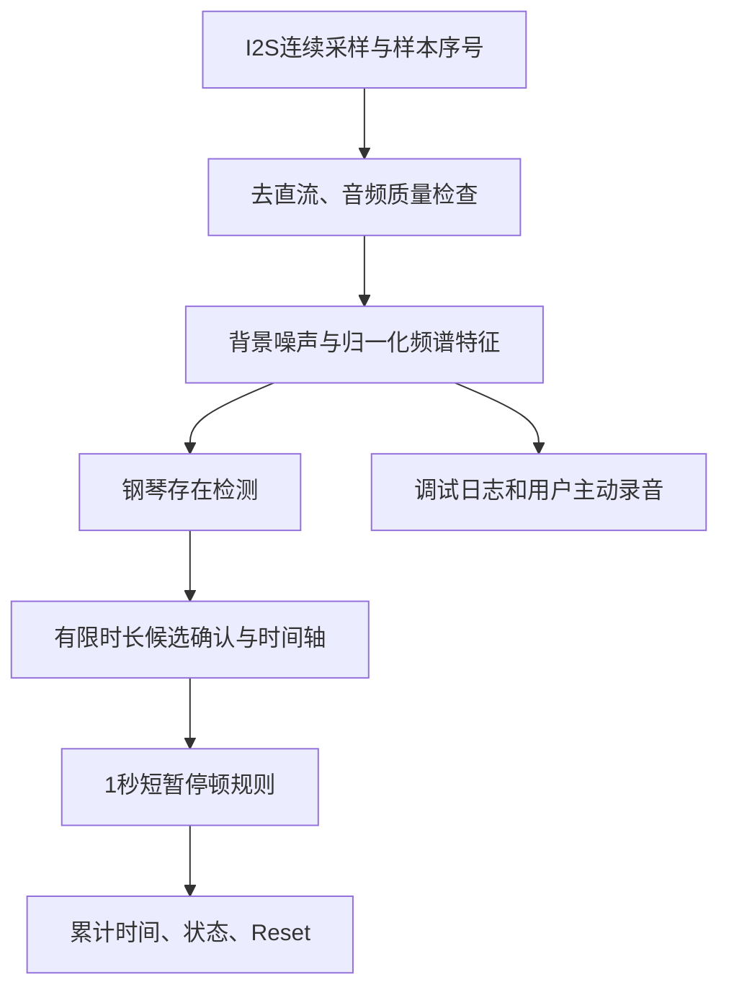

# iot-pianoTimer：第一阶段练琴计时器技术方案

日期：2026-11-11  
适用设备：GUITION JC3636W518C，ESP32-S3，16MB Flash、8MB PSRAM，360×360触摸屏。  
状态：根据 TECHNICAL_REVIEW.md 和用户最新范围决定修订。仅更新设计文档，尚未实施全部算法，不修改现有固件。

## 1. 当前范围

**第一阶段只交付可靠的自动练琴计时器，暂不考虑琴谱比对。**

当前算法只回答“这段音频是否包含钢琴”，不要求识别全部88键、不要求命名和弦、不还原乐谱、不判断错音或节奏。频谱和泛音是声源判断的特征，不是必须输出的音符转录结果。

琴谱加载、跟谱和纠错是独立后续需求，见 [FUTURE_SCORE_SCOPE.md](FUTURE_SCORE_SCOPE.md)。它们不进入本阶段实现、性能预算或验收标准，也不决定计时器能否交付。

## 2. 用户行为与计时要求

| 场景 | 行为 |
| --- | --- |
| 真钢琴轻声、正常、强奏、单音和和弦 | 自动累计 |
| 只有讲话、哼唱或环境噪声 | 尽量不累计，以负样本误计率验收 |
| 钢琴和人声同时存在 | 仍应累计，不以“有人声”为否决条件 |
| 可识别的琴声余音 | 计入 |
| 无声≤1秒，随后继续弹奏 | 事后补计间隔 |
| 无声>1秒 | 整段不计，包括最初等待的1秒 |
| 弹奏结束 | 不赠送额外尾部等待时间 |
| Reset | 清零本次累计、候选状态与待补计间隔 |
| 音频丢块、严重削波或采集故障 | 显示异常；不把丢失数据视为可以补计的静音 |

显示 HH:MM:SS、工作状态、音量、CPU0/CPU1及Reset。保留主动触发的Record用于排查。

单麦克风无法保证区分现场钢琴与播放的钢琴录音；完全淹没在噪声中的琴音也不能保证识别。此为使用边界，不通过降低阈值掩盖。

## 3. Review采纳与事实修正

### 采纳的主要建议

- 计时与琴谱能力拆分，分别定义目标和验收。
- 默认16kHz，24kHz仅在有实际收益时评估。
- 不以最低音区逐键识别作为计时前提。
- 长窗低频精查、NNLS、88键模板和逐键自学习不作为第一阶段必做项。
- FFT与Goertzel/多速率滤波组在同一批录音上比较，不预先指定胜者。
- 模型数据与真实人声误检是主要风险，先离线验证，再上板。
- 噪声冻结设超时和解除条件，避免误把风扇当琴声后永久冻结。
- 候选确认有时限，界面累计只增不减（用户Reset除外）。

### 不能直接当作既定事实的部分

1. **当前录音会写Flash。** OfflineRecorder先缓存PSRAM，采集结束后停止麦克风，再写FFat并读回校验。Review第4节“没有写Flash”的描述不符合现有save()流程。
2. Goertzel“单核1～3%”、FFT“约10%”均是估算，不是当前板的测量值，不能直接用于预算。
3. 低频分辨能力受窗口、加窗、信噪比及多音叠加共同影响，不能用某个音名划定保证准确的分界。
4. 第一版可以只输出“是否包含钢琴”，但**排除纯人声仍是本阶段要求**，不能推迟为后续功能。
5. 暂不为模型新增Flash分区；是否需要独立分区取决于实际模型和升级方式，避免无必要改变现有录音布局。

## 4. 最小可验证架构

钢琴检测先比较以下实现：

| 候选 | 作用与限制 |
| --- | --- |
| FFT频谱/时间特征基线 | 易诊断；不能假定已解决人声排除 |
| Goertzel或多速率滤波组 | 比较频谱集中度、谐波结构等特征；不用256样本强行区分全部低音琴键 |
| 小型“钢琴存在”分类模型 | 用钢琴、人声、噪声和混合数据学习；以实测效果、内存和速度选择 |

最终可以采用小模型与少量DSP特征融合，但不要求三套方案全部在板上运行。若简单方案达到验收，不增加不必要模块；若人声误计不达标，不把松阈值当成解决办法。

## 5. 采音、特征与轻声识别

### 基础配置

- 已确认有响应的I2S左声道；16kHz、单声道PCM作为默认。
- 持续DMA采集，样本时间戳、块序号和丢块检测。
- 启动阶段丢弃瞬态；固定采集增益，检测削波。
- 无依据不更换麦克风、不改变采样率。

### 起始实验参数

- 主频谱：2048点Hann窗，约128ms。
- 更新步长：32～64ms，按精度与处理预算调整。
- 分类时间上下文：候选0.5～1秒；其延迟、内存和精度需测量。
- 只有低音活动漏检成为实际瓶颈时，才增加低频辅助分支；不先引入1秒低音逐键识别。

窗口、步长和最终确认延迟分别记录，不能混为一个参数。

### 轻声策略

- 整体音量只判断信号是否可分辨，不决定来源。
- 使用按频段的背景统计、相对信噪比和归一化频谱形状。
- 结合谐波分布、谱平坦度、频谱变化、起音及衰减；不固定“二倍频必须大于15%”或“起音超过80ms就是人声”。
- 模型/模板包含轻声和强奏，训练中可做合理增益增强，但不能用增强替代真实轻声录音。
- 噪声参考有下限和可信度，防止把纯噪声归一化放大成琴声。

### 避免噪声冻结死锁

- 仅在可信钢琴活动的相关频段暂缓更新，不无条件全频冻结。
- 给冻结设置有限上限；到期重新评估，必要时解除冻结或转入不确定状态。
- 背景只作有界、缓慢调整；“冻结超时”不意味着把持续钢琴强制学成噪声。
- 检测到长期稳定声源、分类冲突或环境突变时，可提示重新做安静校准。
- 用持续风扇、持续钢琴和二者混合专门验证；最终超时及速率由实验确定。

## 6. 人声排除与调律容差

### 人声排除

只输出“是否包含钢琴”即可，负样本必须包括普通讲话、大声讲话、耳语、长元音、哼唱、碰撞与环境声音。

正样本除单独钢琴外，还包括钢琴与讲话重叠。不能将所有有人声的片段都标为负类。遇到证据冲突允许“不确定”，并测量这种保守处理带来的轻声漏计。

Mac完成训练、量化和测试；板端只推理。公开数据可作预训练补充，但最终验收必须包含本板实录。模型输出分数不直接等同于已校准概率。

### 调律与频漂

计时不要求确定每个键的精确音高，优先通过合理频率容差、归一化特征和训练数据中的音高变化提高稳健性。

第一阶段不做在线88键自学习。若实测证明确有必要，可加入用户确认的全局音分偏移。逐键测频、孤立音标定和自动更新作为独立增强，不能成为计时可用的前提。

这样既容忍正常调律差异，也避免“错误识别→更新模板→持续错误”的自举风险。

## 7. 有界确认与只增不减的计时

必须区分：

- 分析/候选确认延迟。
- 无声补计阈值1秒。

二者不能互相替代。

建议采用有限暂存音频时间轴：

1. 未决片段只存候选区，不立刻加入已确认累计。
2. 后续证据确认后，按原始样本时间提交对应区间。
3. 候选被拒绝则丢弃，不从已显示累计中回滚。
4. 候选必须在明确时限内确认；初始实验上限可设1秒，并依据实际窗口评估。不能无限保留未决状态。
5. 丢块、Reset、录音测试等事件打断连续性，禁止跨这些事件补计。
6. 已确认琴声片段之间，按原始音频边界判断≤1秒补计、>1秒排除。

UI在Reset之外只增不减；允许因分析延迟稍晚更新。不能只加一个固定尾部保持时间来防闪烁。分别测试最大确认延迟、音频边界误差和累计时长误差。

## 8. 工程与资源约束

- 采集高优先级；特征/推理和LVGL独立调度。
- DMA与关键工作区优先内部SRAM；长缓存和较大缓冲按性能需要放PSRAM。
- 预分配缓冲，避免每帧申请释放。
- 按真实负载确定双核分工，记录每核CPU、推理耗时、峰值内存、丢块和队列积压。
- 处理超时时报告质量异常，不能静默丢块后仍声称完整统计。
- 提示音默认关闭；如以后使用扬声器，需处理其对采音的污染。
- 默认持续分析但不自动保存原始录音；只有明确点击Record才保存，并显示录音状态。
- 当前录音采用“PSRAM缓存→停止采音→写Flash→读回校验”，练琴计时在测试录音期间暂停。
- 不在持续采音过程中随意增加Flash擦写；若需实时写入，要先验证内部缓冲覆盖停顿及中断安全性。

掉电恢复列为次要增强，不阻塞首次识别验收。若实施，可合并周期性保存累计值，Reset时保存新会话状态，并明确突发断电可能损失的最长时长；同时验证写入暂停和Flash磨损，不假设每分钟写入自动安全。

## 9. 验收数据与指标

### 数据

- 使用明确标签的轻声/正常/强奏钢琴、低中高音、单音、和弦、长余音及踏板场景。
- 负样本覆盖讲话、哼唱、风扇、敲击、翻谱等。
- 包含钢琴与人声重叠，以及不同距离和日期。
- 手机录音用于补充，本板录音是最终验收依据。
- 训练/验证/测试按独立录音时段划分，重复文件不能算独立样本。
- 以声学钢琴活动为标签，不把单音之间的1秒补计规则混入分类标签；计时规则在后处理单独验证。

### 初始目标（待测，不是当前成绩）

| 指标 | 初始目标 |
| --- | --- |
| 普通钢琴活动召回率 | ≥95% |
| 轻声钢琴活动召回率 | ≥90% |
| 纯人声误计时长比例 | ≤1% |
| 代表性练习累计误差 | ≤5%，分别报告漏计、多计 |
| 短停顿规则 | 覆盖恰好1秒、超过1秒、结束不再弹、等待时Reset |
| 音频质量 | 无未报告丢块、无长期处理积压 |
| 显示 | 累计只增不减，Reset除外 |

混合声音、各音区和力度必须分别报告。若目标冲突，展示权衡并与用户确认，不能用平均准确率掩盖轻声漏检或人声误计。

## 10. 实施顺序

| 阶段 | 内容 | 通过条件 |
| --- | --- | --- |
| A：采音与标签 | 确认录音来源、采样格式、强弱音质量，整理本板数据 | 数据可信，场景标签明确 |
| B：Mac离线比较 | 现有规则、FFT特征、Goertzel/滤波组和小模型候选 | 同一独立测试集给出漏计/误计/延迟报告 |
| C：选择最小方案 | 选择能满足计时目标的方法，量化与裁剪 | 精度与资源预算可接受 |
| D：板端实时验证 | 集成采音、判别、时间轴、Reset和显示 | 满足现场识别与稳定性指标 |
| E：工程增强 | 校准体验、环境变化、可选掉电恢复 | 不破坏已通过的识别与计时验收 |

板端CPU预算必须通过真实S3测量复核，不能只用Mac运行时间线性换算。

当前下一步仍为A/B：明确已有钢琴与人声录音标签，用它们建立可复现的计时器离线基线，而不是增加琴谱功能或继续盲调音量门限。

## 11. 参考与关联文档

- [TECHNICAL_REVIEW.md](TECHNICAL_REVIEW.md)：静态审核，算力数字需实测；录音保存路径的事实修正见本方案第3节。
- [FUTURE_SCORE_SCOPE.md](FUTURE_SCORE_SCOPE.md)：独立后续需求，不属于当前交付。
- [PROGRESS.md](PROGRESS.md)：当前实现与未验证事项。
- [ESP-DSP](https://github.com/espressif/esp-dsp)
- [ESP-NN](https://github.com/espressif/esp-nn)
- [Goertzel说明](https://www.mathworks.com/help/signal/ref/goertzel.html)

本方案不表示现有程序已经可靠排除人声；必须通过真实录音与现场测试确认。
